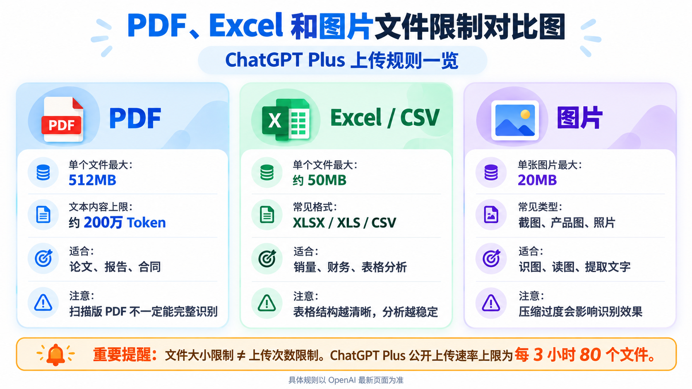

# ChatGPT Plus一天能上传多少个文件？2026年PDF、Excel和图片上传限制详解

**更新时间：2026年10月19日**

本文介绍文件上传频率、单文件大小、Projects项目容量和Library存储限制，并整理上传失败时的排查方法。

ChatGPT Plus一天能上传多少个文件？是80个、100个，还是没有限制？如果每天都需要上传PDF、Excel表格和图片，购买Plus够不够用？

不少用户使用免费版时，上传几个文件就遇到了限制。升级Plus之后，虽然可以处理更多文件，但有时连续上传几十份PDF，系统还是会提示“Upload limit reached”，无法继续上传。

这并不一定是会员出现了问题。

根据[OpenAI官方文件上传说明](https://help.openai.com/en/articles/8555545-uploading-files-and-audio-to-chatgpt)，ChatGPT付费用户的公开上传速率上限为每3小时80个文件，免费版每天最多上传3个。

需要注意，80个指的是3小时内的上传速率限制，而不是Plus每天只能上传80个。OpenAI也可能在系统高峰时段临时降低上限。

另外，上传次数与文件大小是两回事。PDF、Excel和图片分别存在不同限制，上传成功也不代表ChatGPT一定能够完整分析所有内容。

如果你准备购买Plus，主要用于分析文档、整理表格或批量处理图片，下面这些额度规则值得提前了解。

## 一、ChatGPT Plus文件上传限制一览

先看PDF、Excel和图片的文件大小与处理限制：

上传频率、项目容量和存储空间另有以下限制：

| 限制类型 | 公开规则 | 如何理解 |
| --- | --- | --- |
| 文件上传频率 | 最多80个文件／3小时；高峰期可能降低 | 不等于固定每日额度，也不是每种格式各80个 |
| 免费版上传频率 | 最多3个文件／天 | 仍需满足文件大小等要求 |
| Plus项目容量 | 最多25个文件／项目 | 不是整个账号每天只能上传25个 |
| 项目批量上传 | 一次最多10个文件 | 属于Projects入口的批量限制 |
| Plus Library容量 | 最多20GB | 与上传频率分开计算 |
| 共享上传存储 | 每位用户25GB、每个组织100GB | 不应与Library容量直接相加 |

来源：[文件上传规则](https://help.openai.com/en/articles/8555545-uploading-files-and-audio-to-chatgpt)、[Projects说明](https://help.openai.com/en/articles/10169521-using-projects-in-chatgpt)、[Library说明](https://help.openai.com/en/articles/20001052-using-library-to-manage-files-in-chatgpt)。

以上额度分别针对上传频率、文件大小、项目容量和文件库存储，并不是同一种限制。

## 二、每3小时80个文件，为什么不等于每天80个？

假设你上午9点开始上传工作文件。

先上传了20份PDF，接着上传15个Excel表格，再上传10张产品图片。

这段时间总共上传了45个文件。

按照公开的80个文件上限来理解，你尚未达到该3小时窗口的最高上传数量，但能否继续上传，还要看实际账号状态、文件大小、存储空间和当前系统限制。

这个限制采用滚动时间窗口，不应该理解成每天凌晨0点统一刷新，也不代表每隔3小时就一定重新发放完整80次额度。

系统会根据最近一段时间的上传记录判断是否达到限制。

因此，不能直接把80乘以每天的时间窗口数量，再认定Plus每天一定能上传数百个文件。

OpenAI没有公布适用于所有Plus用户的固定每日上传总数。

### PDF、Excel和图片分别有80次额度吗？

官方公开的80个文件限制，是文件上传频率上限，而不是给PDF、Excel和图片分别安排80次。

例如，一次工作流程中先上传PDF，再上传Excel和图片，这些操作都需要关注整体文件上传限制。

除此之外，某些工具、项目或功能还可能存在独立限制。

因此，不建议理解成“PDF可以上传80个，Excel还能再上传80个，图片又有80个”。

如果需要批量处理资料，应该根据实际使用窗口合理安排任务。

## 三、PDF最大能上传多大？有没有页数限制？

PDF是ChatGPT最常用的文件格式之一。

用户可以上传论文、合同、产品手册、行业报告或者其他PDF资料，让ChatGPT提取重点、整理信息和回答问题。

根据OpenAI当前的文件规则，单个PDF最大512MB，同时还受到约200万Token的文档内容限制。

这意味着，即使PDF文件体积低于512MB，也不能保证一定可以完整处理。

OpenAI没有公布一个适用于所有PDF的固定页数，例如“Plus最多上传1000页”。

因为PDF文件大小和实际内容差别很大。

一份200页的纯文字PDF，可能只有几MB；另一份只有50页的扫描件，由于包含大量高清图片，体积可能反而超过100MB。

另外，200万Token主要限制的是文本内容量，而不是PDF页面数量。

所以判断PDF能否上传，不能只看页数。

### 扫描版PDF上传成功，就一定能读取吗？

这是一个容易忽略的问题。

如果PDF来自扫描仪，里面的文字实际上可能是图片，而不是可以直接复制的文本。

OpenAI目前说明，ChatGPT Enterprise支持PDF视觉检索；其他套餐对PDF等文档主要采用文本提取方式。 参考：[PDF视觉检索说明](https://help.openai.com/en/articles/10416312-visual-retrieval-with-pdfs-faq)。

因此，Plus用户即使成功上传扫描版PDF，也不能保证其中的所有图片、图表或扫描表格都能被准确读取。

例如，一份包含大量截图的产品说明书，或者扫描得到的财务报表，ChatGPT可能无法完整识别其中的内容。

如果特别需要分析图片里的数字，可以考虑单独上传相关页面截图，或者先将扫描内容转换成可核对的文本文件。

PDF上传成功，只代表文件进入处理流程，不等于所有内容都已经被完整理解。

## 四、Excel和CSV上传限制：约50MB，复杂表格需要单独处理

Excel的限制与普通PDF不同。

根据OpenAI官方规则，CSV和电子表格的文件大小上限约为50MB，具体还可能受到每行数据大小等因素影响。

因此，不能把普通文档512MB的规则直接套用到Excel。

ChatGPT支持常见的电子表格格式，包括XLS、XLSX和CSV。

文件上传成功，并不意味着ChatGPT一定能处理全部数据。

例如，一个Excel工作簿包含几十张工作表、复杂公式、大量合并单元格，以及不规则的数据结构。

虽然文件只有30MB，但分析时仍可能出现遗漏、处理缓慢或者计算结果不符合预期的情况。

根据[OpenAI数据分析说明](https://help.openai.com/en/articles/8437071-data-analysis-with-chatgpt)，复杂公式、文件结构和数据规模都可能影响处理效果。

对于需要分析销量、库存、广告投放或财务数据的用户，建议尽量保持表格结构清晰。

例如，第一行放字段名称，每行代表一条记录，不要把多个不相关的统计表全部混合在同一张工作表中。

这样比单纯购买更高级的套餐更有助于提高分析质量。

### 多个Sheet算一个文件还是多个文件？

从文件上传数量来看，一个Excel工作簿通常是一个上传文件，即使内部包含多个工作表。

但是，多个Sheet并不意味着ChatGPT可以无条件处理无限多的数据。

如果Excel过于复杂，建议先明确告诉ChatGPT需要分析哪张工作表、哪些字段，以及想计算什么指标。

例如：

> “请读取这个Excel文件中的美国站销量数据，按月份统计销售额、订单量和平均客单价，再列出销售额最高的10个SKU。”

这样的提问通常比直接让ChatGPT“分析整个Excel”更加有效。

## 五、图片上传限制：单张20MB，与图片生成额度不同

不少用户容易把图片上传次数和AI图片生成次数混在一起。

实际上，这两者不是同一个概念。

上传图片是把已有照片、截图、产品图交给ChatGPT分析。

生成图片则是让ChatGPT根据文字要求制作新的图片。

例如，上传一张电商产品图片，让ChatGPT分析画面内容，属于图片上传；要求ChatGPT生成一张YouTube封面，属于图片生成。

OpenAI对它们可能设置不同的使用限制。

对于图片上传，官方公布的单张图片大小上限为20MB。

至于一天能上传多少张，并没有公开一套适用于所有Plus账号、完全独立于其他文件的固定每日图片张数规则。

如果通过普通对话连续上传图片，应同时关注文件上传频率和当前工具限制。

### 图片超过20MB怎么办？

如果图片过大，可以先压缩文件，或者根据实际需要调整分辨率和导出格式。

例如，某张高清图片达到28MB，但只需要让ChatGPT识别其中的文字，可以尝试将图片压缩到20MB以内。

如果画面包含多个很小的文字区域，压缩之前则应该考虑保留足够的清晰度。

否则文件虽然上传成功，文字识别效果却可能变差。

如果处理的是产品参数、软件报错或复杂表格截图，最好保证关键区域可以清楚阅读。

### 一条消息上传多张图片，只算一次吗？

如果上传的是多个独立图片文件，它们属于多个附件，不应该默认一条聊天消息只计算一次文件上传。

例如，同一条消息附带8张图片，和上传一张拼接后的长图，在文件数量上并不相同。

但把多张图片强行拼接，也可能让细节变小、文字难以识别。

所以，没有必要为了减少文件数量而牺牲图片可读性。

## 六、免费版、Go、Plus和Pro有哪些差别？

2026年，ChatGPT免费版同样提供文件上传和分析功能，只是额度更低。

付费套餐通常提供更充足的使用资源，但也存在工具、存储和项目限制。

下面按照目前明确公开的规则，对比几项最容易理解的差异。

| 项目 | Free | Go | Plus | Pro |
| --- | --- | --- | --- | --- |
| 文件上传频率 | 官方公布最多3个／天 | 按套餐和实际账号提示 | 参考公开的最多80个／3小时，并受动态限制影响 | 按套餐和实际账号提示，不在此推定与Plus相同 |
| 单个项目文件数 | 5个 | 25个 | 25个 | 40个 |
| Library存储空间 | 500MB | 4GB | 20GB | 100GB |

项目容量和存储空间分别参考[Projects官方说明](https://help.openai.com/en/articles/10169521-using-projects-in-chatgpt)与[Library官方说明](https://help.openai.com/en/articles/20001052-using-library-to-manage-files-in-chatgpt)。

这里需要注意，文件格式的技术上限不代表免费版与付费版拥有相同的总使用能力。

同时，上表不应理解为Go、Plus和Pro的所有动态上传速率完全一致。实际额度可能根据套餐、账户、系统负载和功能入口调整。

Plus的优势不仅在于可以上传更多文件，还包括更高的分析工具额度及更丰富的模型能力。

如果只是偶尔上传一份PDF或者一张截图，免费版可能已经足够。

如果每天需要分析多个Excel、批量阅读资料，或者持续处理工作文档，Plus会更值得考虑。

## 七、为什么Plus项目只能添加25个文件？

这个问题通常发生在ChatGPT的Projects（项目）功能中。

OpenAI目前公布的规则是：

Plus用户每个项目最多添加25个文件，而Pro用户每个项目最多40个文件。

这里的25个指的是单个项目中可添加的文件数量上限，并不是Plus每天只能上传25个文件。

例如，你创建一个名为“美国市场调研”的项目，在里面添加产品资料、竞品分析、表格和PDF报告。

当项目文件达到25个后，继续往该项目添加文件可能受到限制。

但这不代表你的整个ChatGPT账户当天已经用完全部上传次数。

在Projects中，一次最多可添加10个文件，也不等于每个项目只能上传10个文件。

如果项目文件数量达到上限，可以移除不再需要的资料、合并相关内容，或者根据实际工作主题拆分不同项目。

参考：[OpenAI：ChatGPT Projects说明](https://help.openai.com/en/articles/10169521-using-projects-in-chatgpt)。

## 八、上传次数没用完，为什么仍然无法上传？

ChatGPT文件上传并不只有次数限制。

还有存储空间、单文件体积、项目数量以及工具处理等限制。

例如，Plus用户可能只上传了10个文件，但其中有一个Excel超过50MB，那么这个文件仍可能无法上传。

也有用户上传频率不高，却已经积累大量历史文件，导致文件库存储空间不足。

根据OpenAI现行说明，Plus的Library文件库存储上限为20GB。

此外，官方文件上传说明还列有跨聊天、项目和自定义GPT知识共享的上传存储上限，每位用户25GB、每个组织100GB。

这些属于不同的存储限制，不能把20GB和25GB直接相加当成Plus可用空间。

如果达到任意适用限制，都可能影响文件上传。

### 在哪里查看剩余次数和存储空间？

目前OpenAI没有向用户提供一个统一、可直接查看的滚动文件上传次数余额。

也就是说，你通常无法像查看某些模型消息额度那样，准确看到“80次还剩多少次”。

但对于Library存储空间，可以在文件库中的Storage（存储）按钮查看，也可以按当前界面进入Settings > Storage（设置 > 存储），了解已经使用的容量。

上传次数与存储容量需要分开查看。

## 九、出现“Upload limit reached”怎么处理？

如果ChatGPT出现“Upload limit reached”，通常意味着系统认为当前上传操作达到某项限制。

可能涉及最近3小时上传次数较多、存储空间已满，或者当前系统临时降低了上传速率。

还有一个容易忽略的细节：OpenAI说明，失败的上传尝试有时也可能计入上传频率限制。

因此，如果一直失败，不建议连续点击上传按钮几十次。

可以先检查文件格式、体积、账户套餐，以及[OpenAI系统状态页面](https://status.openai.com/)是否存在服务异常。

如果仍然无法上传，再联系官方支持团队。

### 上传限制多久恢复？

针对公开的每3小时上传速率上限，通常需要等待滚动时间窗口中的部分使用记录退出统计范围。

这与免费版每天3个文件的计数方式不同。

例如，如果在短时间内连续上传大量文件，并且触发了速率限制，就需要等待对应窗口恢复可用空间。

但具体何时可以再次上传，应以实际系统状态为准。

不能认定所有用户都会在整点、凌晨0点或者每隔3小时准时获得完整80次额度。

另外，如果问题是文件库存储容量已经达到上限，单纯等待3小时通常不能解决。

这种情况下，需要先检查存储空间，并在确认不再需要相关文件后进行清理。

## 十、如何提高PDF、Excel和图片的处理效率？

对于经常用ChatGPT处理文档的用户，提升效率并不意味着把所有文件一股脑上传。

如果要分析一份行业报告，先明确需要总结什么信息，再决定是否有必要上传完整资料。

如果需要对比10个Excel文件，最好先确认字段是否一致、数据有没有重复，以及能否合理整合成结构清晰的工作簿。

在图片处理方面，可以将同一组任务集中分析，但不要把重要内容压缩到难以阅读的程度。

这里有几个常见的工作场景。

| 工作场景 | 准备方式 | 可以直接使用的提问 |
| --- | --- | --- |
| 阅读行业报告 | 确认文字可复制，标出重点章节 | 请概括第3章的核心结论，标明对应页码，区分原文事实与推测。 |
| 对比多个销售表格 | 统一日期、币种和字段名称，检查重复订单 | 请按月统计销售额，并说明去重规则和缺失值处理方式。 |
| 分析产品图片 | 保留关键细节，给图片编号 | 请逐张提取可辨认的产品参数，无法看清的内容标注为不确定。 |
| 处理扫描财务报表 | 先OCR并核对关键金额，尽量整理成表格 | 请基于整理后的表格计算合计，并列出计算公式和异常行。 |

另外，如果此前上传的文件已经保存在Library中，可以通过“从文件库添加”重新引用，而不必每次都从本地重新上传一份。

这能够帮助管理资料，也更方便在不同对话中重复使用相同文件。

## 十一、删除聊天会删除文件吗？上传前如何检查数据设置？

这是准备上传商业文件时需要关注的问题。

OpenAI目前提供Library文件库，用于保存和重复使用上传或生成的文件。

需要特别注意，删除一条聊天记录，不一定同时删除保存在Library里的文件副本。

如果想移除已保存的文件，应进入Library，找到相应文件并删除。

另外，个人ChatGPT套餐中的内容是否可能用于模型训练，取决于当前数据控制设置和适用规则。

如果不希望新的个人对话用于改进模型，可以进入设置中的Data Controls（数据控制），关闭“Improve the model for everyone”。 参考：[OpenAI数据控制说明](https://help.openai.com/en/articles/7730893-data-controls-faq)。

如果涉及客户隐私、企业内部资料、财务数据或其他敏感内容，还应该遵守相应的数据处理要求，而不是因为拥有Plus会员就直接上传所有文件。

## 十二、常见问题

### 1. Plus每天只能上传80个文件吗？

不是。官方公开的是每3小时最多80个文件，并非每天固定80个。实际还受到其他限制影响。

### 2. Plus可以无限上传文件吗？

不是。Plus存在滚动上传次数、文件大小、存储空间和项目文件数量等限制。

### 3. 免费版一天能上传几个PDF？

OpenAI目前公布的免费版文件上传限制为每天最多3个文件。PDF属于支持的文件类型，但仍须满足相关体积和内容限制。

### 4. 单个PDF最大支持多大？

单个PDF最大512MB，同时还受到约200万Token的文档内容限制。

### 5. Excel和CSV的大小上限是多少？

CSV和Excel等电子表格的官方上限约为50MB，具体可能受到每行数据大小影响。

### 6. 一次能同时上传几个文件？

在Projects项目中，官方规定一次最多上传10个文件。普通对话的实际批量附件上限可能因使用入口、套餐和功能而不同。

### 7. Plus的25个文件限制是什么意思？

25个通常指单个ChatGPT项目能够添加的文件数量，不是整个账户的每日上传上限。

### 8. 单张图片最大可以上传多大？

每张图片的官方文件大小上限为20MB。

### 9. 上传图片会占用图片生成额度吗？

图片上传和图片生成是不同功能，不能将两者的额度直接混为一谈。具体还需遵守当前工具及账户适用的使用限制。

### 10. 升级Pro一定能解决上传失败吗？

不一定。如果原因是Plus套餐本身的项目文件数或文件库存储空间，Pro可能提供更高容量。

但如果文件已经超过格式限制，或者上传失败来自文件结构和技术故障，升级套餐也不能保证解决。

### 11. 删除聊天能马上恢复上传次数吗？

删除聊天不等于自动恢复滚动上传次数，也不一定会删除Library中保存的文件。应该先判断遇到的是上传速率限制还是存储空间限制。

## 十三、主要用于文件分析，Plus是否够用？

目前OpenAI公布的Plus文件上传速率上限为每3小时80个文件，不能直接理解成每天80个，也不能认为可以无限上传。

不同类型的文件还存在独立的技术限制：

PDF等普通文档单个最大512MB，同时存在约200万Token限制；Excel和CSV约50MB；单张图片最大20MB。

如果使用Projects，Plus每个项目最多可添加25个文件；Library文件库存储空间为20GB。

对于偶尔上传文档、整理资料的用户，免费版可能已经够用。

如果每天都需要分析多个PDF、处理Excel数据或者研究大量文件，Plus会更有实际价值。

不过，是否值得购买Plus，不应该只看上传次数，还要看文件大小、任务复杂程度，以及是否经常遇到功能限制。

如果你的主要需求是高频文件分析，Plus值得考虑；如果只是偶尔上传几张图片或一份PDF，没有必要单纯为了文件上传功能而立即付费。

本文根据OpenAI公开的文件上传、数据分析、项目管理及存储说明整理，最后核对日期为2026年10月19日。具体限制可能随着套餐和产品调整，请以官方最新说明为准。

## 官方参考资料

[OpenAI：文件和音频上传说明](https://help.openai.com/en/articles/8555545-uploading-files-and-audio-to-chatgpt)

[OpenAI：使用ChatGPT进行数据分析](https://help.openai.com/en/articles/8437071-data-analysis-with-chatgpt)

[OpenAI：ChatGPT Projects文件数量限制](https://help.openai.com/en/articles/10169521-using-projects-in-chatgpt)

[OpenAI：Library文件库与存储容量](https://help.openai.com/en/articles/20001052-using-library-to-manage-files-in-chatgpt)

[OpenAI：ChatGPT数据控制说明](https://help.openai.com/en/articles/7730893-data-controls-faq)

[OpenAI：官方套餐价格与功能](https://chatgpt.com/pricing/)

## 订阅与客服

如果想订阅ChatGPT的朋友可以到 [wokee888.shop](https://wokee888.shop) 购买卡密，或添加下方客服一对一处理订阅问题。

