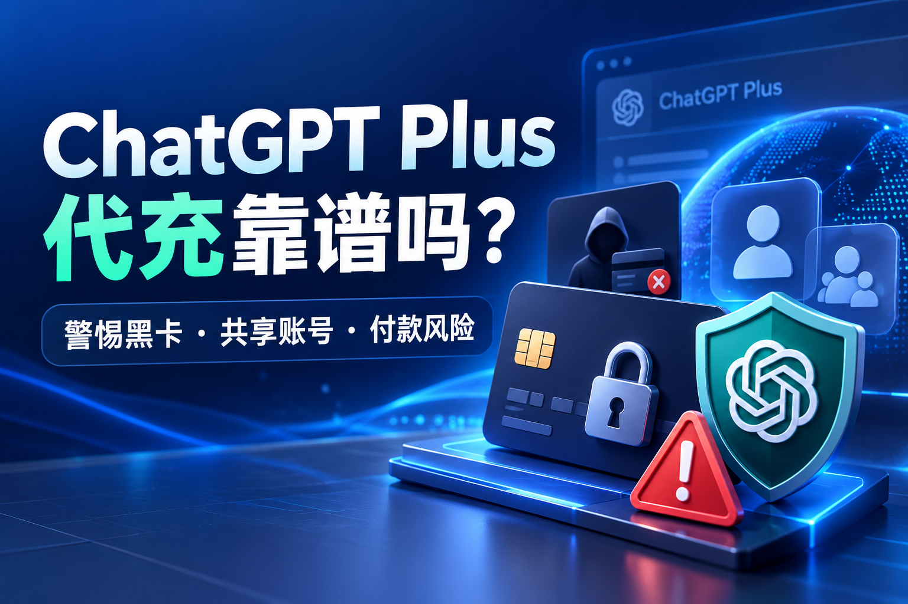

# ChatGPT Plus代充靠谱吗？如何识别黑卡、共享账号和付款风险？

ChatGPT Plus代充已经成为不少国内用户购买AI订阅时会考虑的方式。由于部分用户没有支持国际支付的银行卡，或者在订阅ChatGPT Plus时遇到银行卡被拒绝、支付失败、无法完成付款等情况，第三方代充值服务逐渐受到关注。

不过，ChatGPT Plus代充市场的服务质量差异很大。有些商家提供支付协助，有些则出售现成账号、共享账号，甚至以远低于正常订阅价格的套餐吸引用户。对于初次购买的人来说，最担心的问题往往不是能不能开通，而是付款成功以后，账号能否继续正常使用。

判断ChatGPT Plus代充是否靠谱，关键不在于商家承诺几分钟到账，而在于付款来源是否合法、订阅是否真实生效、账号是否由本人控制，以及出现异常后能否获得有效售后。

## ChatGPT Plus代充到底是什么？

ChatGPT Plus是OpenAI提供的个人付费订阅服务，官方标准价格为每月20美元，具体结算金额可能受到税费、平台及地区定价影响。Plus订阅可提供比免费版更高的使用额度及更多功能，但仍可能存在动态使用限制。

通常所说的ChatGPT Plus代充，是指用户通过第三方商家获得订阅支付协助。市场中常见的服务包括使用授权支付方式为用户完成订阅、协助排查付款失败，以及出售已经开通Plus的账号。

这些方式看起来都能让用户使用付费功能，但风险并不相同。真正需要关注的是：购买以后，你是否仍然使用自己的ChatGPT账号，能否核对订阅状态，以及商家有没有要求你交出密码、验证码或其他敏感信息。

还需要注意，第三方代充商家不应被直接视为OpenAI官方授权合作伙伴。即使店铺提供真实的支付协助，也不代表它获得了官方授权。

## ChatGPT Plus黑卡代充是什么意思？

在ChatGPT充值市场中，黑卡通常指未经合法授权使用的银行卡或支付凭证，例如盗刷卡、被盗用的付款信息等。它与普通虚拟卡、预付卡不是同一个概念，不能因为某张银行卡是虚拟卡，就认定它属于黑卡。

黑卡代充的风险在于，用户看到订阅成功，并不代表底层交易已经稳定完成。若付款后来被持卡人举报、银行认定为未授权交易，或者发生交易争议，相关款项可能进入调查或撤销程序，订阅也可能受到影响。

一些异常低价的ChatGPT Plus代充服务尤其值得警惕。例如，商家声称可以长期以远低于官方价格的成本提供完整独立订阅，却无法解释价格来源、优惠条件或者具体付款方式。

当然，价格低并不等于一定使用黑卡。合法促销、汇率变化、地区定价差异都可能造成最终售价不同。真正危险的是商家无法说明付款来源，同时拒绝提供可核实的订单信息和售后承诺。

消费者通常无法通过账号界面直接判断商家所用银行卡是否合法，因此应优先选择透明、可追溯的付款渠道，而不是只看是否显示Plus标识。

## 共享账号和独立账号有什么区别？

有些商家出售的所谓低价ChatGPT Plus，其实并不是为用户自己的账号开通订阅，而是提供一个已经存在的账号，让多个买家共同使用。

这种共享账号可能价格较低，但存在隐私和使用体验上的明显风险。其他使用者可能看到账号中的历史聊天、文件或个人资料，多人同时使用也可能影响可用额度。账号密码一旦被修改，购买者可能直接失去访问权限。

OpenAI的账户共享政策明确规定，个人账户应由账户创建者本人使用。用户可以在自己的多台设备上登录，但这不等于允许不同用户共同使用同一账号。

因此，如果商家要求你购买一个多人使用的Plus账号，或者只给你一个无法修改密码、无法控制邮箱的现成账号，就需要格外谨慎。

相比之下，由本人创建并长期控制的ChatGPT账号，通常更有利于保护聊天记录、文件和个人使用环境。

## 为什么ChatGPT代充成功后还会出现风险？

部分用户遇到过这样的情况：刚付款时账号确实显示ChatGPT Plus，但几天后订阅状态发生变化，或者到了下个月才发现无法继续使用。

这里可能涉及多种原因，并不一定都是黑卡。

例如，订阅到期后没有续费、付款争议、应用商店订单绑定到其他账号，或者用户登录了错误的ChatGPT账户，都可能造成付费功能无法正常显示。

如果通过Apple App Store或Google Play购买，订阅还可能同时关联应用商店账户与购买时登录的ChatGPT账号。更换登录账户后，不一定能够直接恢复原来的订阅权益。

因此，购买者需要区分正常到期、登录错误、支付争议以及商家未履约，不能仅凭Plus标识消失就直接判定为盗刷。

## 怎么判断ChatGPT Plus代充商家是否可靠？

选择ChatGPT Plus代充服务时，建议先检查商家的实际交付方式。

一个值得认真考虑的商家，至少应该明确告知购买的是哪个套餐、订阅周期多长、使用的是谁的账号，以及后续出现异常如何处理。

尤其需要关注以下细节：

- 是否明确说明服务属于第三方支付协助，而非冒充官方渠道。
- 是否能解释价格构成，避免用明显不合理的低价吸引付款。
- 是否要求用户提交密码、邮箱验证码、恢复码等敏感信息。
- 是否有清楚的售后联系方式、服务期限和退款规则。
- 是否能让用户在自己的账号内核对订阅状态。
- 是否出售多人共享账号，或要求购买者使用来源不明的成品账号。

即使以上条件都满足，也只能说明服务相对透明，不能保证第三方付款完全没有风险。

特别需要提醒的是，商家展示美国信用卡、订单截图或者付款成功页面，都不能单独证明付款工具获得合法授权，也不能保证后续不会发生银行争议。

## 购买ChatGPT Plus以后如何确认是否真的开通？

完成付款以后，应该优先在ChatGPT自己的账户界面确认订阅，而不是只相信商家的付款截图。

用户可以登录自己的ChatGPT账户，打开设置，查看账户和订阅相关信息，核对当前套餐、订阅状态以及可用账单记录。具体菜单名称可能随着产品更新而调整。

如果是在苹果或安卓应用中购买，还应确认对应的Apple或Google Play订阅订单。遇到付款成功但账户仍显示免费版的情况，应先核对登录的账号是否与购买时一致，并根据平台提供的恢复购买功能或官方支持渠道处理。

对于长期使用ChatGPT处理工作文档、客户信息和个人资料的用户来说，保持自己的账号控制权，比单纯追求低价更加重要。

## ChatGPT Plus代充和官方订阅哪个更合适？

从安全性、账号控制权和售后责任来看，能够自行完成官方订阅的用户，应当优先选择OpenAI官网或受支持的官方应用内购买渠道。

如果确实无法独立完成国际付款，可以先排查银行卡类型、账单信息、发卡行限制和支付渠道是否支持，再决定是否寻找第三方支付协助。

第三方服务可能减少部分付款操作上的麻烦，但它同时增加了对商家信誉、支付来源和售后履约的依赖。购买前应充分了解这些额外风险。

对于需要了解ChatGPT Plus、Pro订阅以及Codex额度相关信息的用户，也可以参考[wokeesub.com](https://wokeesub.com)提供的套餐信息和服务说明，结合官方订阅规则比较不同方案。在任何第三方网站下单之前，都应独立核对付款方式、服务内容以及账号安全要求。

## ChatGPT Plus代充常见问题

### ChatGPT Plus代充一定会封号吗？

不能这样判断。账号受到限制可能与多种因素有关，包括账号使用行为、服务条款违反情况以及支付异常。第三方代充本身的具体风险，需要结合实际支付来源和交付方式分析，不能认为所有代充都会导致封号，也不能保证一定不会出现限制。

### ChatGPT Plus代充为什么比官方便宜？

可能涉及促销、地区定价、汇率差异或者不同的交付形式，也可能存在未披露的支付风险。购买者应当重点确认获得的是完整独立订阅，还是共享使用权、临时访问权限或其他不同的商品。

### ChatGPT Plus合租账号安全吗？

多人共用个人ChatGPT账号存在隐私和使用风险，而且不符合OpenAI的个人账户共享政策。对于需要长期保存聊天记录或处理工作资料的用户，不建议将共享个人账户作为主要使用方式。

### 商家代充后，我需要提供邮箱验证码吗？

不建议向第三方提供登录验证码、密码、恢复码或者双因素验证信息。如果某种代充方案必须交出这些敏感信息，应该优先选择其他可由本人完成验证的付款方式。

### ChatGPT Plus付款成功后可以退款吗？

退款取决于购买渠道、交易情况和适用政策。通过官方渠道购买时，可以按照OpenAI或应用商店的规则提出申请；通过第三方商家购买，则需要核对商家的退款条款。遇到疑似未经授权的扣款，应及时联系支付机构及相关官方支持渠道。

## 总结：ChatGPT Plus代充靠谱吗？

ChatGPT Plus代充不能简单分成绝对安全或绝对不安全。真正需要判断的是支付方式是否获得合法授权、订阅是否属于自己的账号、商家是否透明，以及发生问题时有没有可靠的处理渠道。

黑卡支付可能带来后续交易争议，低价共享账号可能造成隐私泄露和访问权限丢失，而要求用户交出密码或验证码的充值流程，则会进一步扩大账号安全风险。

对于准备长期使用ChatGPT Plus的人来说，最重要的不是找到报价最低的商家，而是选择可核实、可控制、风险透明的购买方式。只有同时重视付款安全、账号隐私与后续维护，才能尽量避免充值成功以后又出现不必要的损失。
